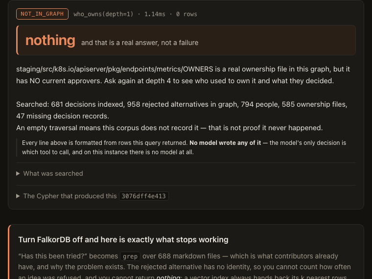
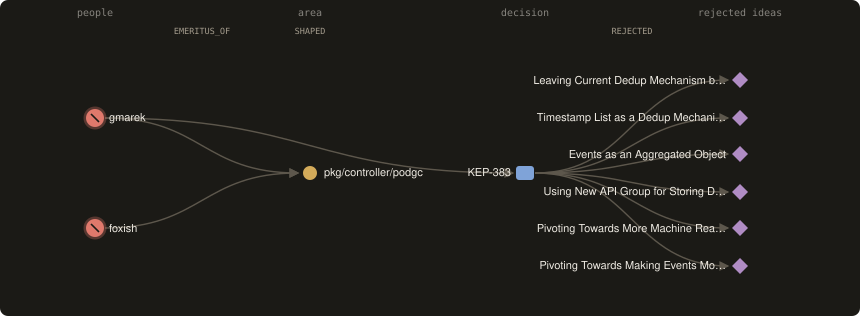
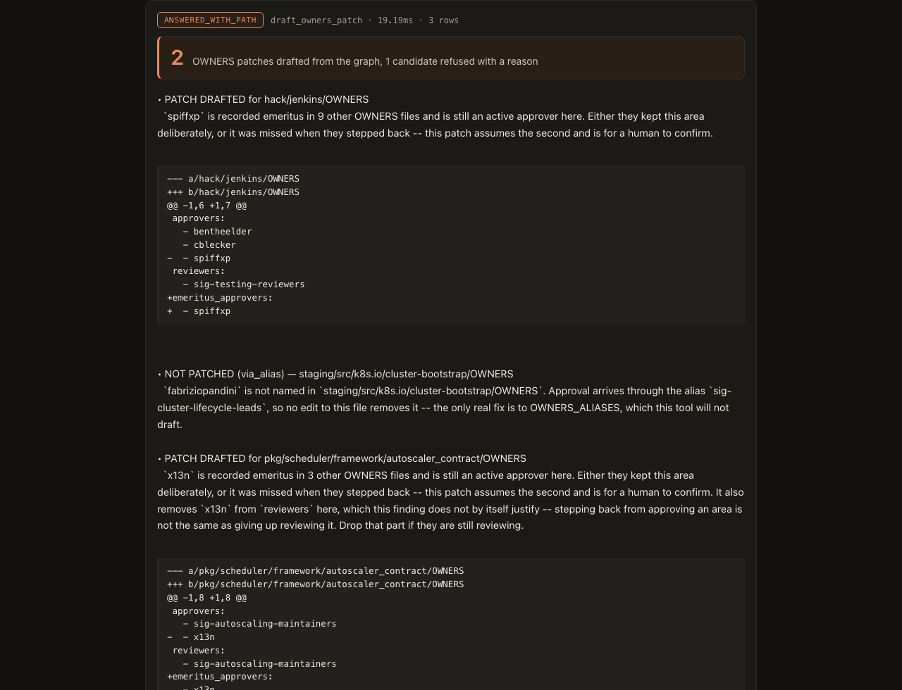
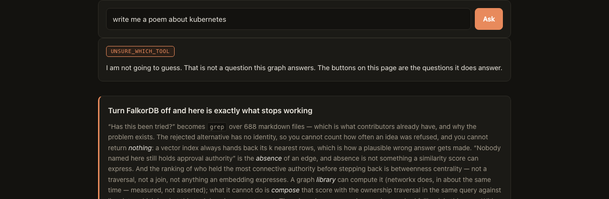

# Tombstone

**The decisions your org already made and forgot. Asked as a graph.**

*A tombstone is what a database writes to record that something is gone.*

Graph Hacks 2026 (WeMakeDevs × FalkorDB) — **Track 3, Company Brain**.

[](https://github.com/aviralgarg05/tombstone/actions/workflows/verify.yml)

> **If you have 60 seconds**
> - **One finding:** one person is the entire review capacity for the Kubernetes apiserver's
>   metrics endpoints. Nobody wrote that down — it is only true as a consequence of the structure.
> - **It acts, not just answers:** it drafts a real OWNERS patch for the inconsistency it
>   finds — and refuses to patch the strongest-looking case, because that file is vendored.
> - **Try it:** `./run.sh`, then open <http://localhost:8099>. **No API key, no account** — and
>   free-text questions work anyway, routed locally.
> - **Check me:** `PYTHONPATH=src ./.venv/bin/python verify_claims.py` re-queries all 36 graph claims against
>   the live graph. `eval_graph_vs_text.py` scores the graph against a text baseline: **24/25 vs 9/25**.
> - **The graph loses one of those twenty-five on purpose,** and ties the baseline nine-all
>   on the control category. See why below.
> - **Live demo:** _not deployed yet — paste the Space URL here._
> - **Nothing here is asserted.** 128 tests, 36 graph claims, 18 rendered UI states, and **two of
>   the five benchmarks** re-run by **31 CI steps on each push** — the other three build a thousand
>   graphs or millions of edges, so they are dated measurements with committed scripts rather than
>   gates, and the page says which is which where it prints them. Including the claims I had to
>   withdraw, which are
>   [marked, not deleted](#three-more-claims-i-stress-tested-and-one-that-was-simply-false).

Large engineering orgs keep re-proposing things they already rejected, because the rejection was
never a thing you could look up. The rejected option isn't a document — it's a 200-word subsection
buried inside a 4,000-word proposal about something else. It has no identity, so you can't count how
often an idea was refused, you can't ask who refused it, and you can't find out whether anyone who
knows why is still around.

> That first sentence is a premise, so I measured it rather than assume it — and **could not
> confirm it on this corpus.** [The measurement is here](#i-tested-this-products-own-premise-and-could-not-confirm-it),
> with the weaker claim that *is* demonstrated. It is the first of several numbers on this page
> that did not survive being checked.

Tombstone makes the rejected alternative a first-class node, attaches the person who killed it, and
answers questions that are each a traversal, not a lookup:

| question | what comes back |
|---|---|
| **Has this been tried?** | the rejected option, its recorded reason, and whether any decider still holds approval authority |
| **Who owns this?** | at depth 1, silence. At depth 4, that every dedicated owner left — and who inherited it |
| **Who inherited this code when its owners left?** | the broader group approval silently fell back to |
| **Whose departure cost the most?** | ranked by **betweenness centrality**, not by file count |
| **What's going stale?** | decisions still cited, still undecided years on, with no author with authority left to ask |
| **Which group is hollowing out?** | communities discovered from co-authorship, ranked by attrition |
| **Who holds an area alone?** | 45 areas have exactly one approver — a bus factor of one |
| **What if they stepped back too?** | the areas that would be left with no owner anywhere |
| **Has this been asked before?** | the prior answer, when, and the live nodes it cited |



*The same question, twice. **Depth 1:** silence — with an honest statement of what was searched.
**Depth 4:** nobody named on that file still holds approval authority, approval has fallen back
to a parent OWNERS with **one** approver, and the person who stepped back personally rejected six
alternatives — one of them titled "Doing nothing is a viable alternative."*



*The path behind an answer, generated from the live API by `scripts_gen_readme_figure.py`.*

It runs on **Kubernetes' own governance record** — a real organisation of thousands of people that
publishes its decision history, its ownership map, and, unusually, its own attrition. Apache-2.0,
fully public. Every number below is checkable with one `git clone`.

**Jump to:** [it drafts the fix](#it-does-not-just-report-the-problem-it-drafts-the-fix) · [what it found](#which-group-is-hollowing-out) · [why a graph](#turn-falkordb-off-and-here-is-exactly-what-stops-working) · [measured vs text search](#does-the-graph-actually-do-work-a-text-search-cannot-measured) · [run it](#quickstart) · [the data model](#the-graph-data-model) · [the Cypher](#the-cypher-this-product-depends-on) · [what I got wrong](#a-correction-i-made-and-why-it-is-in-the-readme)


## Every submission requirement, and exactly where it is

No *scored* criteria are published — I checked both the
[event page](https://www.wemakedevs.org/hackathons/falkordb) and the
[rules](https://www.wemakedevs.org/hackathons/falkordb/rules). The two published standards that do
exist are Rule 10's six-item submission checklist and the track's own
["Key focus" bullets, mapped line by line above](#track-03s-own-key-focus-line-by-line) — including
the one of the five this does not do. Rather than guess at a rubric, here is Rule 10's checklist
with the exact location of each item and an honest status.

| Rule 10 asks for | where it is in this repo | status |
|---|---|---|
| A public source-code repository | this repo, Apache-2.0 | **done** |
| A README with setup instructions and the graph data model | [Quickstart](#quickstart) and [The graph data model](#the-graph-data-model) | **done** |
| The Cypher queries or graph algorithms the product depends on | [The Cypher this product depends on](#the-cypher-this-product-depends-on) — every query generated from `src/tombstone/tools.py`, and **CI fails the build if this README drifts from the source** | **done** |
| A demo video of the working project | `docs/video/walkthrough-silent.mp4` | silent screen walkthrough committed; narrated cut to follow |
| A live deployment, **or** complete local setup instructions if it cannot be deployed | [Quickstart](#quickstart) — `./run.sh`, no API key and no account. A CI job runs the quickstart from a fresh clone on a machine that **already has a container called `falkordb`** — the case that used to break it — and requires the app to reuse that instance, serve, and answer | satisfied via local setup. The hosted deploy is verified end to end by `./scripts_verify_deploy.sh`, which builds the image for `linux/amd64` and runs it as a non-root user exactly as a Space does; it serves, seeds and answers. Only the account token is outstanding. |
| The track you are entering | **Track 3, Company Brain**, stated at the top of this README | **done** |

Two rules beyond the checklist:

- **Rule 11 — disclose AI coding assistant use.** [AI assistance disclosure](#ai-assistance-disclosure).
- **Rules 12 and 13 — the participant must understand and be able to explain the model, the
  queries, the architecture and the decisions.** [`docs/EXPLAIN-IT.md`](docs/EXPLAIN-IT.md) is that
  brief: the questions a judge is most likely to ask, each answered in a paragraph, including the
  five things that are weakest. Its data-model table is re-derived from the live graph by
  `./preflight.sh`, so it cannot quietly describe a different product than the one running.
- **Rule 8 — the main work must begin after the event starts.** Every commit in this repo was
  authored on or after 15 October 2026 IST. That is checkable rather than asserted:

  ```bash
  git log --format='%at' | awk '$1 < 1792002660' | wc -l   # commits before the start; prints 0
  ```

## It does not just report the problem. It drafts the fix.

Track 3's prize is for the agent that "understands how a company works **and gets work done**",
and the brief asks for one that **acts** on connected data. Everything else here answers
questions. This is the part that acts.

The finding it acts on is an inconsistency the organisation created itself. `emeritus_approvers`
is Kubernetes' explicit, written way of saying *this person stepped back from this area*. Three
people are recorded that way in several files while one other file still names them an **active
approver** — so reviews still route to them there.

```
$ open http://localhost:8099  ->  "Draft the fix — don't just report it"

2 OWNERS patches drafted from the graph, 1 candidate refused with a reason
```



*The live app, captured by `scripts_gen_readme_shots.py` through the same deep link you can open
yourself: two patches drafted, one candidate refused mid-list with the reason on its face.*

The drafted patch is a real one:

```diff
--- a/hack/jenkins/OWNERS
+++ b/hack/jenkins/OWNERS
@@ -1,6 +1,7 @@
 approvers:
   - bentheelder
   - cblecker
-  - spiffxp
 reviewers:
   - sig-testing-reviewers
+emeritus_approvers:
+  - spiffxp
```

Both drafts are committed as artifacts: [`docs/patches/`](docs/patches). **Nothing is sent
anywhere** — there is an AST-walking test asserting the drafting path imports no network module.

### The interesting part is what it refuses to do

A tool that emitted a patch for every candidate would be wrong three times over, and each refusal
is a thing the graph knows and a text search does not:

| candidate | what a naive tool would do | what it actually does |
|---|---|---|
| `stewart-yu` — emeritus in **20** files, active approver in exactly **1** | patch it; it is by far the strongest signal in the corpus | **refuse.** That one file is `vendor/k8s.io/utils/ptr/OWNERS`. `vendor/` is synced from another repository, so the edit would be reverted by the next sync. The exclusion is in the Cypher, not bolted on after. |
| `fabriziopandini` — emeritus in 3, active approver in `cluster-bootstrap` | remove his handle from that file | **refuse.** His handle *is not in that file.* Approval arrives by expanding the alias `sig-cluster-lifecycle-leads`. No edit to the file removes it; the only real fix is to `OWNERS_ALIASES`, which this tool will not draft unasked. |
| a file where the straggler is the **only** approver — *no live case in this corpus hits this; both real drafts leave other approvers behind, so this guard is covered by a synthetic test rather than by data* | remove them, leaving `approvers:` empty | **patch, and say the consequence.** An empty `approvers` list does not make a file unowned — it makes it silently *inherit*. The draft names the ancestor that would take over and how many approvers it has. That consequence lives in the OWNERS tree, so only a traversal can state it. |

Each refusal is returned, not dropped: a tool that quietly skipped what it could not handle would
look more capable and be less useful. There is a test asserting the candidate count coming out
equals the candidate count going in.

And it never claims the straggler is a mistake. Stepping back from nine areas and deliberately
keeping a tenth is normal and correct, so every draft carries both readings and is addressed to a
human to confirm. The output is a patch **and the question**, which is the honest shape for this.

Two caveats stated on the face of every draft: the diff is against a canonical re-serialisation of
the *parsed* file — the committed snapshot stores parsed OWNERS structures, so upstream comments
and key order are not preserved — and the full proposed file is appended underneath, because a
minimal diff can reuse an identical line and read misleadingly.

`PYTHONPATH=src ./.venv/bin/python verify_action.py` re-checks every number in this section against a live run.

## Track 03's own "Key focus", line by line

The track page lists five things a Company Brain should do. They are not labelled judging criteria,
but they are the organisers' own words for the track I entered, so they are the closest thing to a
rubric this submission has. Four are answered by the graph. One is not, and saying which one is
cheaper than pretending otherwise.

| Track 03 asks for | where it is here |
|---|---|
| *"Knowledge from docs, tickets, and chats in one graph"* | **Docs only, and deliberately.** 681 decision records and 585 ownership files, in one graph with the 958 rejected options pulled out of their prose as nodes. No tickets and no chats: the rules forbid private company data, and the alternative is a fabricated "Acme Corp" with invented tickets, which proves nothing. Kubernetes is a real organisation of thousands of people that publishes its decision records, its ownership map **and its own attrition**, under Apache-2.0 — so every number here is checkable by a judge in one `git clone`. The attrition is the part that cannot be substituted: `emeritus_approvers` is a field the project maintains about people who stepped back, and a fabricated company has nothing like it while a commit history only *implies* departure. Reading departure out of an implication is precisely the inference [this project got wrong and measured](#a-correction-i-made-and-why-it-is-in-the-readme) — **428 of 595 KEP authors were never approvers at all**, so absence means "never held it", not "has left". [The corpus, and what I refused to ingest from it](docs/K8S-CORPUS-VERIFIED.md). |
| *"Who owns what, and who knows what"* | Two different questions, and the gap between them is the product. 585 ownership files say who owns what *on paper*; **729 of the 794 people** carry expertise edges to decisions they authored, approved or reviewed. **83 people are listed as emeritus somewhere and hold no current approval anywhere** — they are who knows, minus who owns. |
| *"Tracing decisions back to their source"* | **681 of 681** decision records carry their source URL, so every row of every answer traces to the document it came from. Not a sample — all of them, asserted in CI. |
| *"Keeping knowledge current as things change"* | Honest size: 9 `REPLACES`/`SUPERSEDED_BY` edges and **47 records cited by name that do not exist** — knowledge that has already rotted, found structurally. `stale_knowledge` asks what still cites a decision that was replaced, and the agent's own memory stops answering from a remembered finding once the records it cited no longer resolve. |
| *"Answers with clear sources"* | Every answer carries its rows, the exact Cypher, the query's hash, a coverage statement, and a line saying no model wrote the prose. The one thing it will not do is name a plausible owner — [an unrecognised name stops before the traversal](#the-agent). |

## The organisers published what they are looking for. Here is where each piece is.

There are no *scored* criteria published on the event page or the rules — the five bullets above are
as close as the site comes, and they are framed as a track's emphasis rather than a rubric. But
WeMakeDevs published [**How to build an agent that reasons over a graph**](https://www.wemakedevs.org/blogs/how-to-build-an-agent-that-reasons-over-a-graph),
which is the closest thing that exists to a specification. I found it late, in the Resources page,
after building this. The overlap is not a coincidence so much as evidence that the same problems
force the same answers.

| what the article asks for | where it is here |
|---|---|
| *"The agent never writes a query."* A fixed tool catalogue, arguments validated | 13 tools, every query a hand-written constant in [`tools.py`](src/tombstone/tools.py). The model picks a **tool name**; no model output is concatenated into Cypher. On the hosted demo there is no model at all — [routing is local](#free-text-without-an-api-key-and-the-bug-that-made-me-build-it). |
| *"Resolve names against the database"* before reasoning | A query does run first, and it is the resolution query — `MATCH (p:Person {key: $h})` for a handle, `MATCH (o:OwnersFile)` for a path. If it comes back empty the answer is `UNKNOWN_ENTITY` and **the traversal never runs**; the `cypher` field on that answer is empty, which is how the test checks it. The name is checked against the graph before anything reasons about it, which is the order the article asks for. |
| *"Every answer returns one of four shapes"*: answered with a path, answered from memory, not in the graph, unknown | The same four, named the same way, plus `DEGRADED` and `UNSURE_WHICH_TOOL`. [The table is here](#the-agent). |
| *"'Not in the graph' is deliberately not the same thing as 'nothing breaks'"* | A real area with an empty traversal gives `NOT_IN_GRAPH` **with a coverage statement**; a name the graph does not know gives `UNKNOWN_ENTITY`. Different shapes, on purpose. |
| *"Return the path with the answer"*, not an explanation written afterwards | **In substance, yes; as a drawn path, partly.** Every answer carries the rows, the exact Cypher, its hash and a coverage statement, and the prose is formatted from those rows — no model writes it, which is the thing the article is actually guarding against. The *drawn* path appears on 4 of 14 questions: both depths of `who_owns`, `successor_for`, and `what_if_they_go` — the ones whose answer genuinely is a route between named things. The counterfactual's picture is drawn from the verdict in the answer beside it rather than recomputed, and it shows the area that loses its last approver next to two areas the same cohort empties that survive anyway, each with the ancestor it inherits coverage from and the people still approving there (up to two of them, and up to two such areas, so the picture stays readable). That contrast *is* the cascade `GRAPH.COPY` exists to compute. For "which areas have one approver" there is no path to draw, only a list, and inventing a picture for it would be decoration. |
| *"a plausible service name is worse than no answer"* | The README has said *"a plausible wrong name here would be worse than no answer"* since before I read theirs. |
| *"Write it as a node, connect it to what it is about, and read it before you reason"* | `(:Answer)` nodes that `CITED` the records they came from — [and memory only answers while those citations resolve](#it-remembers-what-it-learns). |
| *"Return the date with each remembered finding"* | Recall prints *"asked 1x, last 15 Oct 23:32"* beside every hit. |
| *"Isolate tenants by using separate graphs, not filters"* | **Partly.** The app is single-tenant — it selects one graph at startup and never switches, so there is nothing here to isolate. What I can show is that the mechanism works: [measured to 1000 graphs](#why-falkordb-measured-honestly--including-where-it-loses), isolation is physical, a second tenant running the identical Cypher gets `[]`, and `db.labels()` does not list the label. That is a property of FalkorDB I verified, not a feature this product uses. |
| *"Use built-in algorithms"* rather than reimplementing | `algo.betweenness` (seeded), `algo.labelPropagation`, `GRAPH.COPY`, a vector index — all called, none reimplemented. |
| *"Whether the graph is doing work the agent could not do without it"* | [Turn FalkorDB off](#turn-falkordb-off-and-here-is-exactly-what-stops-working) — and the one place I overclaimed that, I withdrew. |
| *"Demos that compare the same question at different depths"* | Chips **1** and **2**, and beats 1 and 2 of the video: the same question, shallow then four hops. |

The failure modes it says to avoid — guessing names, writing its own queries, summarising reports
it was not given, producing *"a confident sentence nobody can check"* — are the four this product
is built to refuse, and there is a test for each.

## Which *group* is hollowing out?

Individual attrition is a traversal. "Which group is losing its people" is not — because **the
groups are not declared anywhere.** No SIG membership file produces them. They are discovered by
running label propagation over who has actually worked on decisions together, and only then can
you ask what fraction of each discovered partition still holds authority.

```
community #1709 — 25 people, 24% have stepped back
    6 no longer hold approval authority, 5 still do
    e.g. timothysc, ereslibre, ksubrmnn, roberthbailey, rosti
```

A working group where more people have stepped back than still hold authority. Nobody wrote that
group down; it only exists as a property of the collaboration graph.

**Honest limit:** FalkorDB has no Louvain or Leiden, so label propagation is the available
algorithm. It is non-deterministic and has no resolution parameter — run it twice and the
boundaries may shift. The answer says so, and the test asserts structural invariants rather than
exact community ids, because a test pinning those would fail randomly.

## The forward-looking one: what breaks if one more person steps back?

Everything above is archaeology. This is the only question that looks forward, and it is the
clearest case for a graph *database* rather than a graph library.

For **one** person it is an exact query — 45 Kubernetes areas have exactly one approver, and
`apelisse` alone holds six. No simulation needed.

For a **cohort** it is not, because coverage **cascades**: an area survives because its parent
still has an approver, and that parent may be emptied by the same cohort. Answering it means
mutating the whole graph, re-running a recursive traversal over the mutated copy, and diffing —
without touching the original. That is `GRAPH.COPY`: a copy of the freshly seeded graph —
3,087 nodes, 15,735 edges, 7 indexes — takes **roughly 300–460 ms**, varying with machine load
across repeated runs. A single figure here would be wrong on anyone else's machine and was
already wrong on mine, so `PYTHONPATH=src ./.venv/bin/python bench_copy.py` re-measures it and asserts the
part that *is* invariant: that the copy carries the whole graph and its indexes, and the original
is untouched.

```
If deads2k, liggitt, jpbetz, smarterclayton, enj and serathius all stopped approving:
  • 1 area would be left with NO live owner anywhere, not even by inheritance:
      staging/src/k8s.io/kms/OWNERS
  Baseline before the change: 0. Evaluated on a copy; the live graph was untouched.
```

A judge can watch a hypothetical be evaluated and thrown away inside one request. There are tests
asserting the live graph is unchanged afterwards and that no copy is left behind.

**The baseline is 0, and that number is load-bearing.** 19 `OWNERS` files declare only `reviewers`
or `labels` and never had an approver at all. Counting those as "uncovered" would be the same
conflation that produced the retracted orphaned-directories claim — an area with nothing to lose
cannot lose it — so the diff is scoped to areas that actually had approvers. A test asserts the
baseline is zero.

## Keeping knowledge current

Track 3 names this explicitly, and the honest version on a real corpus is not a freshness
timestamp. A decision being old is not interesting. A decision being *still cited by other
decisions*, *still formally undecided years later*, **and** having *no author left who could say
why* — that is knowledge decaying in place. Each signal alone is noise; the conjunction is the
finding, and it needs three different traversals to compute.

```
KEP-583  "Coscheduling"
  provisional for 7 years, still cited by 2 other decisions, sig-scheduling
  1 author no longer holds approval authority; 1 whose status this corpus does not record

KEP-2149 "ClusterID for ClusterSet Identification"
  implementable for 4 years, still cited by 1 other decision, sig-multicluster
  1 author no longer holds approval authority; 2 whose status this corpus does not record
```

**43 decisions are stale-and-still-cited; 2 have an author who no longer hold approval authority and none
who still holds an approver role.**

The wording matters, and my first version got it wrong. I inferred "no living author" from the
*absence* of an approver role — but **428 of 595 KEP authors (72%) appear in no OWNERS file at
all**, so absence mostly means "was never an approver", not "has left". Only `emeritus_approvers`,
an explicit published statement that someone stepped back, is counted as departure; everyone else
is reported as *status not recorded*. `test_absence_from_owners_is_not_treated_as_departure`
guards the confusion.

## Free text without an API key, and the bug that made me build it

The hosted demo has no API key — a personal key cannot safely power a public site. The consequence
was a line I had written myself:

```js
if (!h.llm_configured) { $("q").disabled = true; $("go").disabled = true; }
```

A judge lands on the page and **the most prominent control on it is dead.** That makes an agent
look like a button panel. So free text now works with no key at all, routed locally by the
embedding model already baked into the image.

The contract is deliberately unchanged. Something picks a **tool name**; hand-written Cypher
answers; the renderer phrases it. Turning the key off changes *who picks*, not what runs — and
nothing generated ever reaches a query either way.

| | |
|---|---|
| locked regression cases, in-domain | 10/10 |
| locked regression cases, out-of-domain | 5/5 |
| deterministic across runs | yes — same question, same tool, same score |

Those first two rows are **not an accuracy measurement**, and it would be easy to read them as one.
They are the cases the router was built against, locked so they cannot regress. What it does on
language nobody wrote for it is a different number, measured separately and lower:
[18 of 26 answered, 24 of 26 reachable, 0 routed to the wrong tool](#i-measured-that-router-on-language-it-had-never-seen).

**When it cannot choose, it says so and hands you the choice.** Two tools within `MIN_MARGIN` is a
coin toss, and a coin toss gets declined — but the refusal now carries the candidates it was torn
between and their scores, and the page renders them as buttons. Clicking one is not the router
guessing after all: it declined, showed its work, and a person chose. The arguments are still read
out of the original question by rule, and the chosen name is validated against the same fixed
catalogue, so this is not a way to reach a tool the catalogue does not have.

**It is allowed to refuse, and that took a second attempt.** Routing is an *open* set; the
catalogue is not. A bare similarity threshold cannot tell "unlike anything here" from "a bit like
everything" — *"write me a poem about kubernetes"* scored **0.631** against `draft_owners_patch`
and was accepted, routing a creative-writing request into the tool that **drafts patches**. The
fix was not a higher cutoff but giving the router somewhere correct to land: out-of-domain
examples are modelled as their own bucket, so "none of these" is a thing it can conclude.



*No API key on that instance. It routed the question, decided none of its tools answer it, and
said so.*

```
$ "which areas have exactly one approver?"   -> sole_approver_risk   (0.990)
$ "draft the fix for the ownership problem"  -> draft_owners_patch   (0.874)
$ "write me a poem about kubernetes"         -> I am not going to guess.
                                                That is not a question this graph answers.
$ "who owns this?"                           -> that reads like `successor_for`,
                                                but it needs a handle and you gave none.
```

Arguments are extracted by **rule, never generated**: a path-shaped token, and handles matched
against people who actually exist in the graph — because an invented handle is a fabricated
person. A tool that needs an argument the question never supplied is refused by name rather than
run into a useless "no path supplied".

## I measured that router on language it had never seen

The ten routing cases in the test suite are the cases the router was *built* against. Passing them
says it has not regressed — not that it works on a phrasing nobody wrote for it. So I wrote
[`eval_router.py`](eval_router.py): twenty-six questions phrased the way a contributor would
actually type them, written from what each tool is *for* and deliberately without reading the
router's phrase table first, plus ten things that are not questions about this graph at all.

The first run was worse than the tests implied. **16 of 26**, two routed to the wrong tool, and —
the one that mattered — *"fix my failing unit test"* scored into `draft_owners_patch`, an **action**
tool. The out-of-domain bucket had phrases for poems and weather and none for somebody asking for
coding help, and `draft_owners_patch` is full of the words *fix* and *patch*.

After widening the catalogue's phrasings (none of them copied from the eval, or the eval would
only be measuring itself):

| | |
|---|---|
| answered, correct tool | **18 of 26** |
| routed to a *different* tool | **0 of 26** |
| declined | 8 of 26 |
| of those, the right tool was among the candidates offered | **6 of 8** |
| reachable — answered, or one click away | **24 of 26** |
| not a question about this graph, correctly refused | **10 of 10** |

The zero is the number I care about. It never answers a different question than the one asked; it
either answers, or it says which tools it could not choose between.

**And that refusal stopped being a dead end.** Seven of the eight declines are *margin* failures —
the top two tools within 0.015 — and in four of them the right tool is the one it ranked first and
declined to commit to. The fix was not to lower the bar until it guesses. The refusal now carries
its candidates and their scores, and [the UI offers them as buttons](#free-text-without-an-api-key-and-the-bug-that-made-me-build-it).
Clicking one is not the router guessing after all: it declined, showed its work, and a human chose
— and the arguments are still extracted from the original question **by rule**, so nothing anyone
clicks becomes part of a query. `force` is validated against the same fixed catalogue, because
otherwise it would be a hole straight through it.

The two it still cannot reach — *"where did all the approvers leave"* and *"was storing this in
etcd directly ever considered"* — are named in full by `eval_router.py`'s own output, which
prints every decline with the tool it expected and whether that tool was offered. The table above
counts them; it does not name them, and this sentence used to say it did.

## It remembers what it learns

The brief asks for three things: that the agent acts on connected data, **remembers what it learns**,
and shows how it reached each answer. The third is the path view above. This is the second.

Every answered question is written back as an `(:Answer)` node that **`CITED`s the exact graph nodes
it was built from** — not stored as text. Every answered question, including the ones you reach by
clicking a button: for a while that was false, and only free text was recorded, which made the
whole feature invisible to anyone using the demo the obvious way. Two consequences:

- **Recall is a traversal, not a cache.** A remembered answer can be re-checked against the live
  graph instead of trusted. If a cited node is gone, the memory can say so.
- **Memory lives in the same graph as the facts**, so one query can cross from one to the other:

```cypher
MATCH (a:Answer)-[:CITED]->(p:Person)-[:EMERITUS_OF]->(f:OwnersFile)
RETURN a.question, p.key, count(DISTINCT f) AS areas_they_left
```
```
"whose departure hurt most?"    -> lavalamp    left 31 areas
"which areas have nobody left?" -> vishh       left 14 areas

(rows of the query above, ordered by areas left — not the ranked answer to either
 question. lavalamp left the most areas; he is third by centrality.)
```

(Those rows exist only once those questions have actually been asked — memory starts empty, which
is why a fresh instance returns nothing here and the recall chip answers "never asked".)

That query **starts in memory and ends in facts**. A separate memory store — a vector DB, a Redis
cache — structurally cannot answer it, and would also quietly make the "works without FalkorDB"
test pass, which is precisely the failure the rules describe.

Recall is semantic, so it survives rewording: ask a fresh session *"who currently owns the podgc
controller"* and it finds the earlier *"who owns pkg/controller/podgc?"*, with its citations intact.
There is a test for each of these, and `PYTHONPATH=src ./.venv/bin/python verify_memory.py` re-checks every number in this section against a live run, in CI.

## Turn FalkorDB off and here is exactly what stops working

Rule 3 says a product that still works without the graph is decoration, so here is the honest answer.

- **“Has this been tried?” becomes `grep` over 688 markdown files** — which is what contributors
  already have, and precisely why the problem exists.
- **The rejected alternative loses its identity.** You cannot count how many times an idea was
  refused, because there is nothing to count.
- **You lose the ability to answer *nothing*.** A vector index always returns its k nearest rows no
  matter how far away they are. "Nobody named here still holds approval authority" is the *absence*
  of an edge, and absence is not
  something a similarity score can express.
- **The ranking of whose departure hurt most disappears entirely.** That is betweenness
  centrality: not a traversal, not a join, and not anything an embedding can express. A graph
  *library* can compute it — networkx does, in roughly the same time, and
  [I measured that rather than claim otherwise](#why-falkordb-measured-honestly--including-where-it-loses).
  The difference is that in the library it is a separate process over a separate copy of the
  graph, and the score cannot be **composed with the ownership traversal in the same query** —
  which is exactly what `stepped_back_bridges` does: rank by centrality, then walk from each
  person to the areas they left, in one Cypher statement against live data.

There is **no in-memory mirror and no cached fallback** anywhere in this repo. With the database
unreachable, every endpoint returns `DEGRADED` and says so. There is a test for it
(`test_agent_fails_loudly_without_the_database`) — and, because a unit test proves the code has no
fallback rather than that the deployed thing behaves, `./scripts_verify_deploy.sh` now **kills
FalkorDB inside the running container** and checks what is left:

- health reports `down` rather than claiming to be fine
- a question answered moments earlier comes back `DEGRADED` — **not from memory.** Memory lives in
  the same graph, so it dies with it. A remembered answer served while the records it cites are
  unreachable would be a stale claim dressed as a fresh one, which is the precise failure this
  whole project argues against
- the page itself still returns 200, so a visitor meets an honest error instead of a dead site

On a Space this is not hypothetical: a killed database is what an OOM looks like.

## How do I know the graph is a faithful reading of the corpus?

Every other check here asks the graph a question and asserts something about the answer. That
proves the queries are stable. It does not prove the graph is a correct reading of the files it
was built from — if ingest dropped a field or expanded an alias wrongly, the queries would go on
agreeing with each other and every check would stay green.

[`eval_gold.py`](eval_gold.py) computes the same facts a second time from
[`data/corpus.json.gz`](data/corpus.json.gz) — the committed raw corpus — using **nothing but the
standard library**. No Cypher, no FalkorDB, no `tombstone.tools`; the graph never grades itself.
Then it compares:

```
  gold (no database)        graph
  PASS  ownership files                                   585     585
  PASS  decisions                                         681     681
  PASS  files with exactly one approver                    45      45
  PASS  people recorded emeritus somewhere                111     111
  PASS  people emeritus somewhere, approving nowhere       83      83
  PASS  lavalamp's emeritus files                          31      31
  PASS  spiffxp emeritus files                              9       9
  PASS  spiffxp still approves exactly hack/jenkins/OWNERS -> ['hack/jenkins/OWNERS']
```

**It found a disagreement on the first run, and the graph was right.** My independent
count said 580 ownership files where the graph said 585, because I had counted only the
files that parse to something. Five OWNERS files in the tree declare nothing at all — and an empty OWNERS file is
still a node, because it names no approvers, so everything under it falls through to its parent.
That is exactly the inheritance this product walks. The gold was wrong; the corpus has 585.

**It also checks an ANSWER, not only the structure.** A faithful graph still leaves room for a
traversal that returns the wrong people, so the OWNERS inheritance is walked a second time in
plain Python over the raw records — no Cypher, no database — and compared with what the tool says.
That puts the claim at the top of this page on independent footing: walking the committed files
upward from `staging/src/k8s.io/apiserver/pkg/endpoints/metrics/OWNERS` finds **exactly one
person, `apelisse`**, and the product's answer names the same one. Until this existed, the only
thing confirming that finding was the database it came from.

Writing it took three wrong checks, all of them mine, and each one is worth knowing because the
product distinguishes three things a reader might not:

| | |
|---|---|
| `live_approvers` | who is **named on this file** and still approves. Zero for the metrics file, correctly: it declares reviewers and `emeritus_approvers` and no approvers at all |
| the inheritance walk | who can approve the path once you follow OWNERS **upward**. The same as the first when a file has its own approvers, different when it does not |
| `_inherited_by` | the **fallback parent**. For `pkg/scheduler`, which has its own eight approvers, it names `pkg/OWNERS` — where approval would drop if those eight vanished |

I asked each of those for one of the others' answers in turn, and the product was right every
time. A check that disagrees with the thing it checks is a claim about one of them; it took three
rounds to establish which.

**And it shows which rule is load-bearing.** Disable alias expansion in the gold calculation —
treat `sig-api-machinery-approvers` as a person rather than expanding it to the three people it
names — and "files with exactly one approver" goes from **45 to 247**. The bus-factor answer would
have been five times too alarming, and nothing else in this repository would have noticed.

## Does the graph actually do work a text search cannot? Measured.

The hackathon's one published judging lens is whether the graph does work the agent could not do
without it. Asserting that is cheap, so here it is measured — same corpus, same questions, against
a TF-IDF index built over **every document the graph was built from** (2,224 of them: KEP titles,
statuses, the alternatives prose, OWNERS paths and the handles in them). The baseline sees every
word the graph does.

```
category                      n   graph   text
lookup (control)             10       9      9     a text index ties the graph on its own ground
inheritance                   4       4      0     tree walks to the nearest live ancestor
expertise                     2       2      0     co-ownership counted across two edge types
whole-graph                   2       2      0     betweenness, community detection
absence                       3       3      0     inbound edges to a node that is ABSENT
currency                      2       2      0     age + citations + authority, joined
counterfactual                2       2      0     the graph re-evaluated after a deletion
                                              
                             25      24      9
```

**I wrote these questions and the checks that score them**, on a corpus I chose, which is the
standard weakness of any self-made eval and worth saying before anyone else does. Two things
limit the damage. The control category exists to let the baseline win, and it does — nine-all
over ten questions, 40% of the set. And the *documents* are not mine: the prose is Kubernetes',
written by thousands of people who had never heard of this project, so the gap being measured is
not one I authored on both sides. A competing entry on synthetic data says this plainly about its
own numbers — that unparaphrased generated text "flatters the pattern extractor and lexical
baselines alike" — and that is the half of the problem real documents remove.

**The graph loses one, and that is the point.** It loses the title lookup — "find the KEP about
coscheduling" — and on the control category as a whole the text index *ties it, 9 to 9*. Where a
question is a lookup, a text index competes or wins, and pretending otherwise would make the other
fifteen worthless. Where the answer
is a path, an absence, or a whole-graph property, there is no document to find — **because the
answer was never written down anywhere.** Nobody ever wrote "one person is the entire review
capacity for the apiserver metrics endpoints". It is only true as a consequence of the structure.

```bash
PYTHONPATH=src ./.venv/bin/python eval_graph_vs_text.py     # re-run it
```

## Why not just use Graphiti, Cognee or GraphRAG-SDK?

Fair question, and the honest answer is that for most agent-memory problems **you should** — all
three are mature, and two of them have ~32k stars to this project's zero. They solve a different
problem.

| | Graphiti (31.8k★) | Cognee (32.3k★) | GraphRAG-SDK (1.0k★) | Tombstone |
|---|---|---|---|---|
| what it is | real-time temporal KG for agent memory | general AI memory platform | ontology-driven KG builder (FalkorDB's own) | one corpus, one question shape |
| builds the graph by | **LLM extraction** | **LLM extraction** | **LLM-inferred ontology** | **deterministic parsing** — no LLM touches the extraction path |
| schema | inferred per-episode | inferred | inferred, then fixed | hand-written, 8 node labels |
| re-runs give | different graphs | different graphs | different ontologies | byte-identical graphs |
| cost to rebuild | LLM calls per document | LLM calls per document | LLM calls per corpus | **zero, 1.1s** |
| best at | conversational memory that accumulates | heterogeneous sources | bootstrapping a KG from prose | a corpus whose structure is already machine-readable |

**The distinction that matters here.** Kubernetes already publishes its governance as structured
data: `kep.yaml` has `replaces`/`superseded-by`, `OWNERS` has `approvers` and `emeritus_approvers`,
and the KEP template *mandates* an `Alternatives` section. An LLM extraction pass over that would
be strictly worse — it would cost money, vary between runs, and hallucinate relationships that the
YAML states exactly. **752 of the 958 rejected alternatives are extracted by a regex over
sub-headings, not a model.**

So the LLM in this project does exactly one job: picking which of thirteen tools to call. It never
writes Cypher, never extracts an entity, and never phrases a finding. Swap it out and the graph is
unchanged.

Where those three would beat this: anything whose source is prose with no structure — meeting
notes, Slack, support tickets. Tombstone would have nothing to parse.

## Why FalkorDB, measured honestly — including where it loses

An adversarial reviewer argued the real incumbent at this scale isn't Postgres, it's `networkx`.
Fair. This page carried a comparison answering that for most of the project's life, **with no
script behind it**, quoting a graph of "3,300 nodes / 39,987 edges" — which is not this product's
graph. So I wrote the benchmark against the real one and ran it.

`PYTHONPATH=src ./.venv/bin/python bench_vs_networkx.py` — needs `pip install networkx scipy` first, a comparison-only dependency the product itself never imports, which is why it is not in `requirements.txt`; the script says so rather than failing with an import error — the product's own seeded graph, **3,087 nodes,
15,735 edges**, both engines cross-checked to agree on the result before being timed. Median of
three runs:

| operation | networkx | FalkorDB v4.22.1 | winner, across runs |
|---|---|---|---|
| build graph *(not comparable — see below)* | 8 ms | 765–803 ms | networkx 94–99x |
| 2-hop neighbourhood (p50) | 0.004 ms | 0.3 ms | **networkx 80–93x** |
| WCC | 2.1 ms | 5.4–10.2 ms | **networkx 2–5x** |
| **betweenness (k=32, seed=42)** — *used by `stepped_back_bridges`* | 25 ms | 16 ms | FalkorDB 1–2x |
| PageRank — *benchmarked, used by no tool* | 338–456 ms | 5.7–15.1 ms | FalkorDB **30–145x** |

**The ranges are wider than they were, because re-running kept moving them.** A loaded machine
gave PageRank 30x where this table had claimed 54–145x, and WCC 5x against a claimed 2–3x.

Then I tried to gate on the ratios — arguing that absolute milliseconds are machine-dependent but
a ratio would survive a change of machine — **and CI proved that wrong within the hour.** The same
code gives betweenness 2x on this laptop and **6x on a GitHub runner**, and WCC 5x here against
1x there. The build went red for a claim that was never false; the hardware had changed.

So neither the milliseconds nor the ratios are asserted. **The table is one machine** — median
of three runs on the laptop described above — and not a range spanning hardware: the runner
figures in the paragraph before it, betweenness 6x and WCC 1x, both fall outside their table
rows, which is the point rather than an oversight. The script prints what the run in front of
you measured, and a divergence from either is information. **What is gated is the cross-check**: both engines must agree on the
answer — the same number of weakly-connected components — before either is timed. A benchmark
where one engine is quietly solving a different problem is worse than no benchmark, and that is
the part a machine cannot make wrong.

**This table replaces one that claimed FalkorDB won betweenness by 18x and PageRank by 153x, and
that networkx won WCC.** None of those survived measurement on the real graph. The old numbers
came from a larger synthetic graph — 2.5x the edges — where the sparse-matrix engine has more to
work with. On *this* graph the honest reading is:

> **Speed is not why this needs FalkorDB.** networkx is faster at everything except PageRank,
> which no tool here calls, and roughly ties on betweenness, which one does. If the only thing
> this product did were compute betweenness over 3,000 nodes, networkx plus a JSON file would be
> the right engineering choice and I would be wrong to use a database.

Two caveats that cut against me, stated rather than buried: the build row is **not a like-for-like
comparison** — FalkorDB's figure includes loading the snapshot, ingesting and creating seven
indexes, while networkx is handed an edge list already in memory — and PageRank's 30–145x is the
one lopsided row, on the one algorithm nothing uses.

So the case for a graph database here is the structural one, and it is the one
[the removal test](#turn-falkordb-off-and-here-is-exactly-what-stops-working) actually exercises:
a vector index composed with traversal **in a single query**; `GRAPH.COPY` to evaluate a
counterfactual against a mutated whole-graph copy and throw it away inside one request; memory
that lives in the same graph as the facts, so one query starts in memory and ends in facts;
durable persistence; physically isolated per-tenant graphs; concurrent access to live shared
state; and a path object returned by the query that found the answer. networkx does none of those,
and a JSON file does fewer.

One benchmarking bug worth recording, found by the cross-check rather than by reading: on
v4.22.1, `CALL algo.WCC(NULL, NULL)` — the two-argument form, by analogy with
`algo.pageRank(NULL, NULL)` — **silently returns zero rows instead of erroring.** The previous
"WCC 4.5 ms" figure was the cost of computing nothing. `CALL algo.WCC()` is the form that works.
The benchmark now makes both engines agree on the component count before it times either, which
is what caught it.

Multi-tenancy, re-measured 1 → 1000 graphs with `spikes/tenancy_bench.py`. **Two of these claims
did not survive being re-run**, so here is the corrected version:

| tenants | read p50 | read p99 | KB/tenant |
|---|---|---|---|
| 1 | 0.33 ms | 3.77 ms | 512.8 |
| 100 | 0.49 ms | 1.45 ms | 504.9 |
| 500 | 2.19 ms | **12.79 ms** | 494.3 |
| 1000 | 2.25 ms | 6.69 ms | 491.7 |

These are a recorded measurement, not an asserted one: re-running it creates a thousand graphs,
which is too expensive to put in a gate that has to stay fast enough to run before every push.
That is the same distinction the networkx table draws, and worth stating here so the two are not
read as equally guarded — the ratios in that table *are* checked on every run; these numbers are
dated, scripted and reproducible by hand.

What holds: **memory is linear at 491–513 KB/tenant**, and **isolation is physical** — a second
tenant running the identical Cypher gets `[]`, and `db.labels()` does not even list the label.
Creating 1000 tenant graphs took 5.4 s, and `select_graph` stays negligible (0.4 → 3.6 µs).

What does not: read p50 **does not stay flat**. It goes 0.33 → 2.25 ms, roughly 7x, though still
comfortably under 3 ms. And p99 is **too noisy to claim a trend from a single run** — 1.45 ms at
100 tenants, 12.79 at 500, 6.69 at 1000. This paragraph previously said p50 stayed flat (0.42 →
0.38 ms) and p99 *improved* (2.34 → 0.82 ms). Both were one run's noise read as a signal, which is
the same mistake as [the networkx table](#why-falkordb-measured-honestly--including-where-it-loses)
in a smaller key.

Honest caveat that does survive: 10,000 tenants × ~491 KB ≈ 4.8 GB, so FalkorDB's "10K+ graphs"
headline is memory-bound, not architecture-bound.

Full methodology, the engine gotchas, and **nine ways a check lied to me** — each one passing or failing for a reason unrelated to what it measured: [`docs/GROUND-TRUTH.md`](docs/GROUND-TRUTH.md).

## Quickstart

```bash
git clone https://github.com/aviralgarg05/tombstone && cd tombstone
./run.sh
```

**Python 3.11–3.14, and `run.sh` sorts it out.** If there is no `.venv` it builds one, choosing
an interpreter in that range, and installs into it. That is deliberate and it was learned twice.
The quickstart first read `python3.13`, which fails with `command not found` on a machine without
exactly that version. Naming `python3` instead moved the failure to a `ResolutionImpossible` wall
from pip on a machine whose `python3` is 3.15 — measured here, on a clean clone, which is how I
know. Both stop a stranger at the first line, and the help that would fix it lives in a file they
never get to run.

Not 3.15: `fastembed` needs `onnxruntime`, which publishes wheels for cp311–cp314 only, so
`pip install` there fails with a wall of version lines that never mentions Python. `run.sh` and `preflight.sh` check the version first and name a working
interpreter you already have. **The hosted demo is unaffected** — the image installs its Python
from a pinned base, runs 3.13.5, and `scripts_verify_deploy.sh` asserts that before deploying, so
a future base bump that carried Python out of range fails there rather than on the Space. I found this by cloning fresh on a machine whose default `python3`
had moved to 3.15 — the documented command simply did not work, which is the sort of thing you
only learn by running it rather than by having run it once a while ago.

`run.sh` prefers `./.venv` if it exists, so there is nothing to activate. It needs Docker running,
and it tells you plainly if Docker or a dependency is missing rather than failing halfway.

Then open <http://localhost:8099>. **No API key needed, and the ask box still works** — see
[routing without a key](#free-text-without-an-api-key-and-the-bug-that-made-me-build-it).
`run.sh` starts FalkorDB, seeds it from the committed snapshot in **~1.1s**, and serves the app.

Adding a key (copy `.env.example` to `.env` — Anthropic, OpenAI, Gemini or Groq, auto-detected)
swaps the router for a model. It changes *who picks the tool*. It does not change what runs.

```bash
./preflight.sh                                # all of the below, one command, one verdict
PYTHONPATH=src ./.venv/bin/python -m pytest tests/ -q     # 128 invariant tests
PYTHONPATH=src ./.venv/bin/python verify_claims.py        # re-queries the 36 graph claims
```

```bash
PYTHONPATH=src ./.venv/bin/python eval_retrieval.py       # 12 paraphrases + 3 negative controls
PYTHONPATH=src ./.venv/bin/python eval_graph_vs_text.py   # graph vs a TF-IDF baseline on the same corpus
```

`verify_claims.py` exists so you can falsify any factual claim here in one command. It queries the
live graph and compares against the number printed in this file.

**What it does and does not prove.** It checks this README against a graph built from the committed
snapshot — that is internal consistency, not external truth. The external check is different and
cheaper: every row the product returns carries a `github.com` URL, so you can click through to the
`OWNERS` file or the KEP and read it yourself. `eval_graph_vs_text.py` is the one that tests a
claim about the world: that these answers are not recoverable from the text alone.

Age-dependent claims are checked against a **live clock**, not a frozen one — an earlier version
hard-coded a timestamp, which meant the staleness numbers could never go stale themselves, which
rather defeats the point. Counts marked *as of 15 October 2026* will drift as decisions age past the
three-year line; set `AS_OF_MS` to pin the same instant this README used.

CI runs all three of these against a real FalkorDB on every push, plus a check that the Cypher
catalogue below has not drifted from `tools.py` — the README claims those queries are generated
from source, and a stale block would make that claim false.

`eval_retrieval.py` scores the headline tool on twelve paraphrases a contributor might plausibly
type, written without looking at the corpus first: **12/12 return a real titled rejected option with
a substantive recorded rationale.** It also runs three negative controls — ideas this corpus should
not know about — and **3/3 correctly return nothing**. A retrieval layer that never returns nothing
is not telling you anything.


**Any answer is a link.** `?run=<tool>` runs that chip on load and `&focus=1` strips everything
above the result, so you can be sent to an answer rather than to an empty box:

```
http://localhost:8099/?run=draft_owners_patch&focus=1    # the drafted patches, nothing else
http://localhost:8099/?run=who_owns&i=1                  # the same question, four hops deep
```

The walkthrough video is built by screenshotting exactly those links, which is why
`python scripts_build_walkthrough.py` can regenerate it and why it fails rather than shipping a
stale cut if the app is not serving.

## The graph data model

Required by Rule 10. The two **latent** labels are the whole idea: neither is a document, a person
or a file, so neither exists in any search index anywhere.

```
NODES
  (:Kep           {key, num, title, status, status_raw, sig, stage, created_ms:int, url})
  (:Alternative   {key, title, body, kep, titled:bool})          ← LATENT: a rejected design option
     :NamedOption                                                 ← titled subset; carries .emb
  (:MissingRecord {key, cited_by:int})                            ← LATENT: a decision record that
                                                                     others cite but which is GONE
  (:Person        {key})                                          alias-expanded, bots removed
  (:OwnersFile    {key, path, url})
  (:Sig           {key})

RELATIONSHIPS
  (:Kep)-[:CONSIDERED]->(:Alternative)        (:Kep)-[:OWNED_BY]->(:Sig)
  (:Kep)-[:REPLACES|SUPERSEDED_BY|SEE_ALSO]->(:Kep)
  (:Kep)-[:CITES_MISSING]->(:MissingRecord)
  (:Person)-[:AUTHORED|APPROVED|REVIEWED]->(:Kep)
  (:Person)-[:APPROVES]->(:OwnersFile)        ← a CURRENT owner
  (:Person)-[:EMERITUS_OF]->(:OwnersFile)     ← a DEPARTED owner. The project writes its own
                                                 knowledge loss into this field and nothing reads it.
  (:Person)-[:CO_AUTHORED {w:int}]->(:Person) ← projection, computed in Cypher (see below)

INDEXES
  CREATE VECTOR INDEX FOR (a:NamedOption) ON (a.emb)
         OPTIONS {dimension: 384, similarityFunction: 'cosine'}
  CREATE INDEX FOR (k:Kep)        ON (k.key)
  CREATE INDEX FOR (p:Person)     ON (p.key)
  CREATE INDEX FOR (o:OwnersFile) ON (o.key)
```

**Why `:NamedOption` is a label and not a property.** FalkorDB vector indexes cannot filter by
property — a shared index forces you to post-filter, so you ask for *k* and keep *k/N*. Minting a
label gives a genuinely pre-filtered ANN index with no recall loss.

**Why `CO_AUTHORED` exists.** Centrality over the raw bipartite `Person-[:AUTHORED]->Kep` graph is
degenerate: every score 1.0, every community size 1. The projection is a 2-hop co-occurrence over
shared decisions, **computed in Cypher by the database** (5,879 edges, ~95ms) — not in numpy and
written back, which would mean the algorithm was partitioning a matrix the database never computed.

```cypher
MATCH (a:Person)-[:AUTHORED|APPROVED|REVIEWED]->(k:Kep)<-[:AUTHORED|APPROVED|REVIEWED]-(b:Person)
WHERE a.key < b.key
WITH a, b, count(DISTINCT k) AS shared
MERGE (a)-[e:CO_AUTHORED]->(b) SET e.w = shared
```

## What's in the graph

| | count |
|---|---|
| decisions (`:Kep`) | 681 |
| rejected alternatives (`:Alternative`) | 958 — of which **752 are titled, named options** |
| missing decision records (`:MissingRecord`) | 47 (cited 55 times) |
| people | 794 |
| ownership files | 585 |
| `APPROVES` / `EMERITUS_OF` | 2,584 / 298 |
| `CO_AUTHORED` | 5,879 |

**What the drawn picture labels its edges, and what each one really traverses.** Six of the eight
labels on the reasoning path are *summaries*, not relationship types, and it is worth saying so
plainly because a judge who looks for them in `CALL db.relationshipTypes()` will not find them.
One of them used to lie about this: the counterfactual drew `INHERITS_FROM` between two files with
no such edge between them, because the walk behind it is `*1..8` and the file in the middle has no
approvers at all. A test now refuses any drawn label that is neither a real type nor listed here.

| drawn on the picture | what it actually traverses |
|---|---|
| `APPROVES`, `EMERITUS_OF` | themselves — real edges, drawn as they are |
| `SHAPED` | `AUTHORED` or `APPROVED`, collapsed into one line |
| `REJECTED` | `CONSIDERED` — every one in this corpus comes from an Alternatives section |
| `INHERITS COVERAGE` | `INHERITS_FROM*1..8`, stopping at the first ancestor that still has an approver |
| `STILL APPROVES` | `APPROVES`, minus the cohort being removed |
| `LEFT BEHIND` / `ALREADY APPROVES` | `EMERITUS_OF` / `APPROVES`, from the two sides of a handover |

Findings that fall straight out of it, each checkable:

- **55 of 358 internal decision pointers (15.4%) don't resolve.** One missing record,
  `/keps/sig-api-machinery/0006-apply.md`, is cited by **four** separate decisions.
- **83 of 111 people listed as emeritus hold no approval authority anywhere.**
- **7 areas lost every *dedicated* approver** — see the correction below; they are not unowned.
- `lavalamp` is emeritus in **31** ownership files — more than anyone else — and is only **third**
  by betweenness among departed contributors (115.97, sampled, seed pinned). `logicalhan` is first
  at **156.46**, having left just five areas behind. That gap is the finding: counting the files
  someone walked away from ranks them by volume, and the question worth asking is how much
  *connective* authority left with them. This line previously said lavalamp had the highest
  betweenness, at 196.1 — wrong on both the ranking and the number, and contradicted by the demo
  script standing beside it, which has always narrated lavalamp as third.

## The agent

Eleven tools. The model picks one and fills its arguments; hand-written Cypher answers; a
deterministic renderer phrases it. **The model never writes a query and never phrases a finding**,
so it cannot soften a negative into a maybe or name someone who isn't in the graph.

Every answer is one of six shapes:

| shape | meaning |
|---|---|
| `ANSWERED_WITH_PATH` | found it, and here is the traversal |
| `ANSWERED_FROM_MEMORY` | asked before — and the nodes that answer cited **still resolve** |
| `NOT_IN_GRAPH` | the traversal ran and returned nothing — **always** with a coverage statement |
| `UNKNOWN_ENTITY` | the name didn't resolve, so nothing else ran |
| `DEGRADED` | the graph is unreachable. No fallback. |
| `UNSURE_WHICH_TOOL` | the question was understood as *not one of these* — the router declined rather than guess |

`ANSWERED_FROM_MEMORY` is **earned, not cached.** It is only returned when the prior answer's
citations still resolve *and* re-running the tool returns the same rows — so what you read is the
live result, with the memory noted. If the cited nodes have gone, the memory is discarded and the
tool re-runs, because a remembered answer whose evidence has vanished is a stale claim rather than
a memory. There is a test that deletes the citations and asserts the agent stops calling it one.

Entity names are resolved against the graph *before* any traversal, because a plausible wrong name
is worse than no answer. And a negative never stands alone — an empty traversal only means this
corpus doesn't record it, which the UI says in those words every time.

## The Cypher this product depends on

Required by Rule 10. These are generated from `src/tombstone/tools.py` by
`python scripts_gen_readme_cypher.py`, so they are the queries that actually run — not a retelling.
Every one is hand-written and parameterised. **The model never composes a query**; it picks a
tool name and fills its arguments, and no model output is ever concatenated into Cypher.

### `has_this_been_tried` — Has this idea been proposed and rejected before — and is anyone who made that call still here?

*Why a graph:* Vector KNN seeds the search, then the graph supplies what no embedding holds: which decision recorded it, who decided, and whether any of them still approve anything. A vector store alone returns the k nearest rows and can never return *nothing*.

```cypher
CALL db.idx.vector.queryNodes('NamedOption', 'emb', $k, vecf32($qvec)) YIELD node AS alt, score
// Seven titles in this corpus are section headings the extractor lifted as if they were options
// -- 'Pros', 'Cons', 'Pros/Cons' and friends, twelve nodes in all. They are embedded, so a vague
// question reaches them: "what are the tradeoffs here" answered with 'Pros/Cons', a heading
// dressed as a rejected idea. Excluded by name rather than by pattern, because ACL, API and VPA
// are three letters long and are real options. Re-extracting the corpus is the proper fix and is
// not a thing to start two days from a deadline.
WITH alt, score
WHERE NOT alt.title IN ['Cons', 'Cons:', 'Not', 'Other Solutions:', 'Pros', 'Pros/Cons', 'Pros:']
WITH alt, score WHERE score <= $maxDist
MATCH (kep:Kep)-[:CONSIDERED]->(alt)
OPTIONAL MATCH (kep)-[:OWNED_BY]->(sig:Sig)
OPTIONAL MATCH (author:Person)-[:AUTHORED|APPROVED]->(kep)
OPTIONAL MATCH (author)-[liveRole:APPROVES]->()
WITH kep, sig, alt, score,
     collect(DISTINCT author.key) AS deciders,
     count(DISTINCT liveRole)     AS decider_live_roles
RETURN alt.title                             AS rejected_idea,
       alt.body                              AS rationale,
       kep.num                               AS kep,
       kep.title                             AS kep_title,
       kep.status                            AS status,
       sig.key                               AS sig,
       kep.url                               AS source_url,
       CASE WHEN kep.created_ms = 0 THEN -1
            ELSE ($now - kep.created_ms) / $msYear END AS years_ago,
       deciders,
       decider_live_roles,
       CASE WHEN decider_live_roles = 0 THEN 'NO_LIVING_OWNER' ELSE 'HAS_LIVING_OWNER' END
                                             AS rationale_ownership,
       round(score * 1000) / 1000            AS distance
ORDER BY score ASC
LIMIT $limit
```
`query_sha` = `3fbc6d5ae250` — stamped on every answer this query produces.

### `ownership_dilution` — Which areas lost every DEDICATED approver, and which broader group inherits them now?

*Why a graph:* Kubernetes OWNERS inherit, so finding who actually covers a directory means walking UP the tree until you hit live approvers — a variable-length traversal. One area falls back two levels because the directory in between is also dead.

```cypher
// 1. areas where every dedicated approver has departed
MATCH (departed:Person)-[:EMERITUS_OF]->(area:OwnersFile)
OPTIONAL MATCH (own:Person)-[:APPROVES]->(area)
WITH area, collect(DISTINCT departed.key) AS departed_owners, count(DISTINCT own) AS own_live
WHERE own_live = 0

// 2. walk UP the OWNERS tree to the nearest ancestor that still has live approvers
MATCH path = (area)-[:INHERITS_FROM*1..8]->(anc:OwnersFile)
MATCH (fb:Person)-[:APPROVES]->(anc)
WITH area, departed_owners, anc, length(path) AS up, count(DISTINCT fb) AS n_fb
ORDER BY up ASC
WITH area, departed_owners,
     collect({path: anc.path, up: up, n: n_fb})[0] AS nearest

RETURN area.path             AS area,
       departed_owners,
       size(departed_owners) AS n_departed,
       nearest.path          AS approval_falls_back_to,
       nearest.up            AS levels_up,
       nearest.n             AS fallback_approvers,
       area.url              AS source_url
ORDER BY fallback_approvers ASC, n_departed DESC
LIMIT $limit
```
`query_sha` = `b0145239cfc7` — stamped on every answer this query produces.

### `departed_bridges` — Whose departure cost the most CONNECTIVE knowledge — not just the most files?

*Why a graph:* Betweenness centrality is a whole-graph property. No traversal, no SQL join and no embedding can compute it. Composed with an ownership traversal in the SAME query.

```cypher
CALL algo.betweenness({nodeLabels:['Person'], relationshipTypes:['CO_AUTHORED'], samplingSeed: $seed})
YIELD node, score
WITH node AS p, score AS bridge
MATCH (p)-[:EMERITUS_OF]->(f:OwnersFile)
OPTIONAL MATCH (p)-[liveRole:APPROVES]->()
WITH p, bridge, count(DISTINCT f) AS abandoned_areas, count(liveRole) AS live_roles
WHERE live_roles = 0 AND abandoned_areas >= $minAreas
RETURN p.key                        AS stepped_back_bridge,
       round(bridge * 100) / 100     AS betweenness,
       abandoned_areas
ORDER BY bridge DESC
LIMIT $limit
```
`query_sha` = `55dbf28e5314` — stamped on every answer this query produces.

### `successor_for` — Who already co-owns the areas a departed person left behind?

*Why a graph:* A co-ownership overlap across two relationship types. In SQL this is two self-joins whose result still cannot be returned as a path.

```cypher
MATCH (dep:Person {key: $handle})-[:EMERITUS_OF]->(f:OwnersFile)
WITH dep, collect(DISTINCT f) AS abandoned
UNWIND abandoned AS area
MATCH (cand:Person)-[:APPROVES]->(area)
WITH dep, cand, size(abandoned) AS total_abandoned, count(DISTINCT area) AS shared
MATCH (cand)-[:APPROVES]->(owned:OwnersFile)
RETURN cand.key                 AS candidate,
       shared                   AS shares_areas_with_departed,
       total_abandoned          AS departed_total_areas,
       count(DISTINCT owned)    AS candidate_total_areas
ORDER BY shared DESC, candidate_total_areas DESC
LIMIT $limit
```
`query_sha` = `81f20b2d0b57` — stamped on every answer this query produces.

### `broken_lineage` — Which cited decision records do not exist?

*Why a graph:* Inbound edges to a node that stands for something MISSING. Finding it requires resolving references across 681 decisions and counting arrivals at the gap.

```cypher
MATCH (k:Kep)-[:CITES_MISSING]->(m:MissingRecord)
WITH m, collect(DISTINCT k.num) AS citing_keps, count(DISTINCT k) AS cited_by
WHERE cited_by >= $minCites
RETURN m.key AS missing_record, cited_by, citing_keps
ORDER BY cited_by DESC, m.key
LIMIT $limit
```
`query_sha` = `032f655b6aa7` — stamped on every answer this query produces.

### `who_owns` — Who owns this area? (depth 1 — what any database serves)

*Why a graph:* A single join. Included deliberately as the control arm of the depth contrast.

```cypher
MATCH (p:Person)-[:APPROVES]->(o:OwnersFile {path: $path})
RETURN p.key AS approver, o.path AS area, o.url AS source_url
ORDER BY approver
LIMIT $limit
```
`query_sha` = `3076dff4e413` — stamped on every answer this query produces.

### `draft_owners_patch` — Whose ownership record is lopsided — and can it be safely patched?

*Why a graph:* The query behind the one ACTION this agent takes. It needs a whole-repository view of one person's ROLE in 585 separate files: recorded as stepped back in many, still named an active approver in one. grep finds every file containing the handle; it cannot tell approver from emeritus from reviewer, and cannot rank by the lopsidedness. The vendored-tree exclusion is in the query because the strongest-looking candidate in this corpus is a vendored file that must not be patched.

```cypher
MATCH (p:Person)-[:EMERITUS_OF]->(e:OwnersFile)
WITH p, collect(DISTINCT e.path) AS stepped_back
WHERE size(stepped_back) >= $min_stepped_back
MATCH (p)-[:APPROVES]->(a:OwnersFile)
WHERE NOT a.path STARTS WITH 'vendor/' AND NOT a.path STARTS WITH 'third_party/'
WITH p, stepped_back, collect(DISTINCT a.path) AS still_listed
WHERE size(still_listed) <= $max_active
RETURN p.key              AS person,
       size(stepped_back) AS stepped_back_in,
       stepped_back[0..5] AS stepped_back_sample,
       still_listed       AS still_listed_in
ORDER BY stepped_back_in DESC, person
LIMIT $limit
```
`query_sha` = `5cb3370ef8a4` — stamped on every answer this query produces.

### `who_owns` — Who owns this area? (depth 4 — what the graph serves)

*Why a graph:* Four hops: area → the owner who stepped back → decisions they shaped → alternatives they personally rejected → the SIGs those reached. Returns the reason depth 1 was silent.

```cypher
MATCH (o:OwnersFile {path: $path})
OPTIONAL MATCH (live:Person)-[:APPROVES]->(o)
OPTIONAL MATCH (dep:Person)-[:EMERITUS_OF]->(o)
WITH o, collect(DISTINCT live.key) AS live_approvers, collect(DISTINCT dep) AS departed
UNWIND (CASE WHEN size(departed) = 0 THEN [null] ELSE departed END) AS d
OPTIONAL MATCH (d)-[:AUTHORED|APPROVED]->(k:Kep)-[:CONSIDERED]->(a:Alternative)
OPTIONAL MATCH (k)-[:OWNED_BY]->(sig:Sig)
WITH o, live_approvers, d,
     collect(DISTINCT k.num)   AS decisions_they_shaped,
     collect(DISTINCT a.title) AS ideas_they_rejected,
     collect(DISTINCT sig.key) AS sigs_touched
RETURN o.path                    AS area,
       live_approvers,
       d.key                     AS departed_owner,
       size(decisions_they_shaped) AS n_decisions,
       decisions_they_shaped[0..5] AS sample_decisions,
       ideas_they_rejected[0..4]   AS sample_rejected_ideas,
       sigs_touched,
       CASE WHEN size(live_approvers) = 0 THEN 'NO_DEDICATED_OWNER' ELSE 'OWNED' END AS status
LIMIT $limit
```
`query_sha` = `1174754e3277` — stamped on every answer this query produces.

## Where the data comes from

| source | licence | what is used | how it is extracted |
|---|---|---|---|
| [kubernetes/enhancements](https://github.com/kubernetes/enhancements) | Apache-2.0 | 681 `kep.yaml` records; the `Alternatives` / `Drawbacks` / `Risks` sections of 688 READMEs | YAML parse + markdown sub-heading regex. **No LLM.** |
| [kubernetes/kubernetes](https://github.com/kubernetes/kubernetes) | Apache-2.0 | 585 `OWNERS` files — `approvers`, `reviewers`, `emeritus_approvers`, `options` | YAML parse, group aliases expanded via `OWNERS_ALIASES` |
| [kubernetes/kubernetes `OWNERS_ALIASES`](https://github.com/kubernetes/kubernetes/blob/master/OWNERS_ALIASES) | Apache-2.0 | 74 aliases → 449 memberships | YAML parse |
| `BAAI/bge-small-en-v1.5` | MIT | 384-dim embeddings of 958 alternatives | local, via `fastembed`. No API. |

**Not ingested, deliberately:** the email addresses published in `kubernetes/community`'s
`sigs.yaml`. The rules forbid personal data, so a `Person` node carries exactly one property —
the GitHub handle — and nothing else: no name, no address, no affiliation. This sentence used to
say affiliations were in; they are not. A person's SIG association is never read from a
membership file, it falls out of the decisions they actually worked on, which is why the graph
holds `Kep -[OWNED_BY]-> Sig` and no edge at all between a person and a SIG.

Modifications to the redistributed material are listed in [`NOTICE`](NOTICE), as Apache-2.0 §4
requires — the snapshot contains verbatim KEP prose.

## I tested this product's own premise, and could not confirm it

The first sentence of this README says large orgs keep re-proposing things they already rejected.
That is the motivation for everything here, and I had never measured it. So I did:
`PYTHONPATH=src ./.venv/bin/python measure_repeat_rejections.py`.

Compare all 752 named rejected alternatives pairwise by embedding, keep pairs belonging to
different decisions, and ask whether the record **already links** those two decisions through
`REPLACES`, `SUPERSEDED_BY` or `SEE_ALSO`.

| | |
|---|---|
| cross-decision pairs sharing a near-identical alternative | **3** |
| of those, already linked in the record | **3** |
| re-proposals this corpus can demonstrate | **0** |

All three are a successor KEP carrying its predecessor's Alternatives section forward — which is
exactly what should happen, and which the record already captures. The band just below
near-identical holds 31 pairs that are *topically adjacent* rather than the same idea: "add pod
index as a label" sitting near "generic `managed-by`". Counting those as repeats would be the
same overclaim this product exists to avoid, so they are excluded and named.

**So the premise is not demonstrated on this corpus, and I am not going to pretend otherwise.**
What is demonstrated is the weaker, sufficient claim: a rejected alternative is not retrievable
today — it has no identity, no index entry and no owner — so the question *"has this been tried?"*
cannot currently be asked at all, by anyone, at any scale. This makes it askable. Whether the
answer then comes back "yes, twice" is the organisation's business, not the tool's.

Finding no silent repeats is a result. The measurement is committed, it runs in CI, and it fails
if these numbers ever stop matching the table above — so if a real re-proposal does appear, this
README gets a better story than the one it has now.

## A correction I made, and why it is in the README

An earlier version of this claimed **7 directories were "orphaned" — no current approver at all**.
That was **wrong**, and it was the demo's centrepiece.

Kubernetes OWNERS files **inherit**. [The docs are explicit](https://www.kubernetes.dev/docs/guide/owners/):
an OWNERS file "applies to everything within the directory, including ... child directories", and a
child is covered by its ancestors unless it sets `options.no_parent_owners`. I checked all seven:
**every one is covered by an ancestor. Zero are unowned.** `pkg/controller/podgc` falls back to
`pkg/controller/OWNERS`, which has 10 live approvers.

The true finding is better, and more graph-shaped. Those directories lost every *dedicated*
approver, so approval **silently widened** to people who never owned that code — and finding who
inherited it requires walking the tree:

```
apiserver/pkg/endpoints/metrics   lost logicalhan
  -> falls back 1 level to apiserver/pkg/endpoints -- 1 approver
cluster/gce/windows               lost yujuhong, yliaog, pjh, mtaufen, ibabou
  -> falls back 2 levels to cluster/ -- the directory in between is also dead
```

`test_no_directory_is_actually_unowned` now fails loudly if the wrong claim ever creeps back.
Of 585 OWNERS files, 57 set `no_parent_owners`; none of those is left without a live approver.

## Three more claims I stress-tested, and one that was simply false

Having got the ownership claim wrong, I assumed others were wrong too and went looking.

**"83 of 111 departed owners hold no current approver role" — is that circular?**
It would be, if `emeritus` automatically meant "gone from everything". It does not: **28 of the
111 are emeritus in one area and still actively approve elsewhere** — `sttts` is emeritus in 1
file and still approves 70. So the 83 are people who stepped back from *everything*, which is a
real signal rather than a restatement of the field's definition. Claim survives.

**"X% of internal decision pointers don't resolve" — decay, or just moved files?**
Partly the latter, and my first number was inflated. Two references point at legacy flat-layout
`.md` records that still exist, and one used `/kep/` instead of `/keps/` — a typo whose target is
unambiguous. Resolving those honestly moves the figure from **63/363 (17.4%) down to 55/358 (15.4%)**. The corrected resolver is in `corpus.py`, and the 19 legacy records are carried in the
snapshot so a snapshot build and a live build cannot disagree.

**"It remembers what it learns" — did I ever check that on the demo people actually use?**
No, and it was false there. The section above has been in this README for most of the project's
life. It was true on the path a model routes, and silently did nothing on the keyless path —
which is the hosted configuration, the one a judge opens. `ask_locally` called a memory method
that **does not exist**, inside a bare `except Exception: pass`, so every question recorded
nothing and no repeat ever came back remembered. Underneath that, **seven of thirteen tools were
never wired into the citation linker**, so they recorded zero citations — and since the gate for
returning an answer from memory is that its citations still resolve, a tool with none can never
fire. And `who_owns` records itself as `who_owns(depth=4)` while the lookup used the bare name,
so those two never matched either.

All three are fixed and the claims above are now verified live: a repeat keyless ask returns
`ANSWERED_FROM_MEMORY` citing 42, 22 and 6 real nodes depending on the tool. The structural cause
was duplication — the keyless flow was re-implemented from memory and got it wrong — so both
paths now go through one `Agent._remember`, and a test asserts that *every* answering tool cites
the nodes it returned, which is the invariant whose absence hid seven of them.

It is the same bare-except failure that fabricated a missing record for KEP-5075, described
further down this page, committed again in new code by the person who wrote that paragraph.

## What "stepped back" means here, precisely

`emeritus_approvers` is Kubernetes' own field, and
[the docs define it exactly](https://www.kubernetes.dev/docs/guide/owners/): those people
"can no longer approve code (use the `/approve` command)" and are "ignored by prow for assignment".

So this product says someone **holds no approval authority** — a mechanical, prow-enforced fact.
It does **not** say they left the project, and it must not. I checked: `k82cn` (Klaus Ma), whose
name appears against the oldest stale decision here, pushed public commits **today**. People step
back from reviewing an area for many reasons and stay entirely active. An earlier draft of this
README said "departed" and "has left" throughout. That was wrong about real, named people, and
the wording is now the narrower thing the data actually supports.

## On sourcing

Four claims in this project turned out to be wrong, all the same shape: **a strong conclusion
inferred from missing or second-hand evidence.**

| claim | what was wrong |
|---|---|
| "7 directories are orphaned" | ignored that Kubernetes OWNERS **inherit** — none is unowned |
| "63 of 363 pointers broken" | some targets had **moved**, not vanished — it is 60 |
| "2 decisions have no living author" | 72% of KEP authors were **never** approvers; absence ≠ departure |
| "organizer guidance, verbatim: 3 minutes" | **not on any official page** — a research agent misattributed it |

The last one is the one I mind most: it put an unverifiable quote in a public repo whose whole
pitch is checkable claims. Every organizer attribution has been removed or marked unverified, and
every number *in this section* is re-checked by `verify_claims.py` against the live graph. Not
every number on the page: the benchmark timings are a measurement on one machine and are
[reported rather than gated](#why-falkordb-measured-honestly--including-where-it-loses), which
the table says where it prints them. Writing "every number here is re-checked" was the easier
sentence and it is the kind this very section exists to apologise for.

The irony is not lost on me. This is a product about honest negatives, and I committed the exact
failure its design warns about — *"an empty traversal means your graph does not know"* — four
times. Each fix made the claim narrower and more defensible.

## Honest limits

- **A few embedded options are section headings, and the query now excludes them.** Lifting named
  options out of prose is a regex over sub-headings and it is not perfect: of the 752 titles that
  get embedded, **seven are headings rather than alternatives** — `Pros`, `Cons`, `Pros/Cons`,
  `Other Solutions:` and so on, twelve nodes in all. They were reachable, and I found it by asking
  a deliberately vague question: *"what are the tradeoffs here"* used to answer **`Pros/Cons`**, a
  heading dressed as a rejected idea. `has_this_been_tried` now excludes those seven titles **by
  name**, not by pattern, because `ACL`, `API` and `VPA` are also three letters long and are real
  options. The same question now answers *"Offset-based pagination"*, and the specific questions
  are unchanged. The nodes stay in the graph, because they are what the corpus says; they are just
  not in the haystack. Re-extracting the corpus is the proper fix and not a thing to start two days
  from a deadline, so `eval_gold.py` pins the count and asserts the exclusion holds.

- **KEP numbers are not unique, and one pair proves it.** 681 decision records carry 680 distinct
  numbers: **2133 exists under both `sig-cloud-provider` and `sig-node`**, because Kubernetes
  reused it when *Kubelet Credential Providers* superseded *Out-of-Tree Credential Providers*. The
  graph keeps both records, which is right. But tools that resolve a citation by number — and this
  product's lineage queries do — would match both. Nothing in the corpus currently cites 2133, no
  alternatives hang off either record, and no answer references it, so no answer today is affected.
  It is a sharp edge rather than a bug, and `eval_gold.py` pins the count so a future ingest that
  collapses the pair fails instead of quietly losing a decision. Found by reconstructing every
  source URL from the raw corpus and noticing that one number had two.
- **Betweenness is sampled**, not exact (`samplingSize` 32). The seed is pinned so the number is
  reproducible, but it is an approximation and the UI says so.
- **206 of 958 alternatives are outside the search, and most of them are real.** This line used
  to say they were "untitled prose", which was comfortable and wrong. Of the 206: **19 are list
  markers** (one is literally `1.`), 24 are short fragments — and **163 are 60 characters or
  more of substantive text describing a rejection that genuinely happened**. One reads *"We
  considered extending `kube-state-metrics` to represent all of the data necessary…"*. That is not
  an artefact; it is a real rejected alternative whose extracted title came out as a sentence
  because the KEP described it in a paragraph instead of a sub-heading.
  They are in the graph, so `ownership_dilution` and the lineage queries see them. They are **not
  embedded**, so `has_this_been_tried` cannot find them — ask about `kube-state-metrics` and that
  rejection does not come back. That is a recall gap of up to 163 rejections out of 958, and
  calling it an artefact count hid it. Embedding sentence-length titles would also degrade every
  similarity query, so the real fix is a better extractor, not a wider index — and that is a
  re-ingest, which is not a thing to start two days from a deadline. Measured, not estimated, and
  pinned by `eval_gold.py`.
- **7 of 681 decisions have no usable date** — 3 omit the field entirely, 2 still carry the
  template's literal `'yyyy-mm-dd'`, and 2 give a month above twelve (`2023-14-05`,
  `2025-30-01`), presumably a day-month transposition. "Presumably" is not a date, so they stay
  unusable rather than being guessed at; all seven render as "date not recorded", never as an age.
  This said *8 of 679* until I counted it: the figure predated later corpus changes, and the
  breakdown was wrong too. Three more decisions wrote their date without zero-padding
  (`2024-2-1`, `2023-9-18`, `2025-10-9`), which `fromisoformat` rejects — those were being thrown
  away for a formatting habit and are now parsed, since they are unambiguous.
- Some sub-headings inside an `Alternatives` section are structural ("Implementation sketch") rather
  than real options. The deterministic parser cannot always tell.
- "No current approver" means *this corpus* records none. People own things informally.
- The corpus is a snapshot. Re-run `python src/tombstone/snapshot.py` against fresh clones to update.
- **Memory has no cap, no eviction and no TTL**, which is deliberate — an answer citing live
  nodes is evidence, not cache, and evicting it would make `ANSWERED_FROM_MEMORY` mean less.
  What bounds it is that a repeat merges onto the same node: measured, 30 identical questions
  produce **one** `(:Answer)` with a counter at 30, and all thirteen chips clicked twenty times
  each produce seven nodes. So growth is per **distinct** question, at **~48 KB** — dominated by
  the node and its 384-float embedding rather than by its citations, since a tool citing 42 nodes
  and one citing few both cost about the same. Against the hosted demo's ~100 MB of headroom that
  is roughly **two thousand** distinct questions. The stored question text is itself capped at 400
  characters, so a padded one costs no more than a short one. There is a test on the merge,
  because changing it to a create would remove the bound silently.
- **The hosted demo is not rate-limited.** It needs no key by design, so there is nothing to meter
  by. Normal use cannot approach the bound above — the thirteen chips contribute thirteen
  questions however often they are pressed — but a determined crawler sending thousands of
  *distinct* free-text questions could. Said plainly rather than discovered.
- **The counterfactual needs memory headroom to fork.** `GRAPH.COPY` copies the graph in the
  server process, so on a small box, or when two counterfactuals overlap, it can fail with
  "could not fork". Measured: the whole app — FalkorDB, the embedding model and a copy in
  flight — peaks at **~400 MB and runs inside a 512 MB container without being OOM-killed**, and
  repeated copies do not grow it, so the copies are genuinely dropped. **Concurrency is a
  different number**: six counterfactuals at once peak around **900 MB**, because each `GRAPH.COPY`
  materialises a whole graph — measured, they OOM a 768 MB container and a 1 GB one and survive at
  2 GB. The hosted tier has far more. The deploy check gives the container 2 GB and asserts the
  *serial* peak stays under 512 MB, so a serial regression still fails there rather than as a
  crash on the demo. It
  retries once, and if it still cannot copy it returns `DEGRADED` saying so — which is not
  theoretical: **six counterfactuals fired at once into a 512 MB container answered five and
  degraded one, with no errors, no hung requests and no OOM.** Judges share links, so concurrent
  use of one container is the normal case, and that is the behaviour it was built for. It never reports a number from a copy that did not happen — a counterfactual that
  answered "0 areas would be left unowned" because the diff was empty would be the worst bug
  this product could have, so there is a test that drives that exact path.

## AI assistance disclosure

Built with AI coding assistance, as the rules permit and require disclosing.

The graph model, the tool boundaries, every Cypher query, the benchmark methodology and the
engineering decisions are mine. Every performance number here comes from a committed script I ran
and can re-run: [`bench_vs_networkx.py`](bench_vs_networkx.py) for the comparison table above and
[`bench_copy.py`](bench_copy.py) for the `GRAPH.COPY` timing, both at the repository root, and the
longer-running ones — the thousand-graph tenancy measurement and the edge-scale probe — under
[`spikes/`](spikes). This sentence used to send you to `spikes/` for all of them, which is where
the two that matter most are not. Where a research agent's figure disagreed with my own parse, **my parse
is used and the discrepancy is recorded** — the `OWNERS_ALIASES` correction in
`docs/K8S-CORPUS-VERIFIED.md` is one example, where an unexpanded group alias had turned 71 of 866
"people" into committees and understated ownership by 1,595 edges.

## Stack

Python · FalkorDB **v4.22.1** (pinned — `:latest` is untrustworthy and 6.x drops `algo.AStar`/`CCH`
and carries crash and silently-wrong-result bugs) · `fastembed` + BGE-small for embeddings, running
locally at ~5ms/query with no API cost · FastAPI · hand-written SVG for the path view, no graph
library.

Data: [kubernetes/enhancements](https://github.com/kubernetes/enhancements) and
[kubernetes/kubernetes](https://github.com/kubernetes/kubernetes) OWNERS, both Apache-2.0. No email
addresses are ingested, even though `sigs.yaml` publishes them — Rule 6 says "personal".

